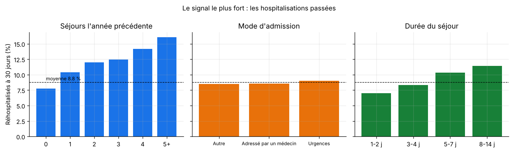
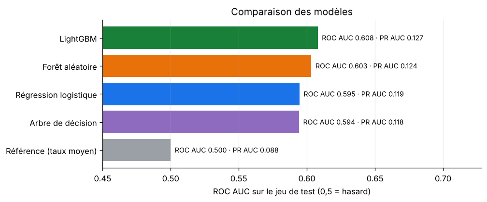
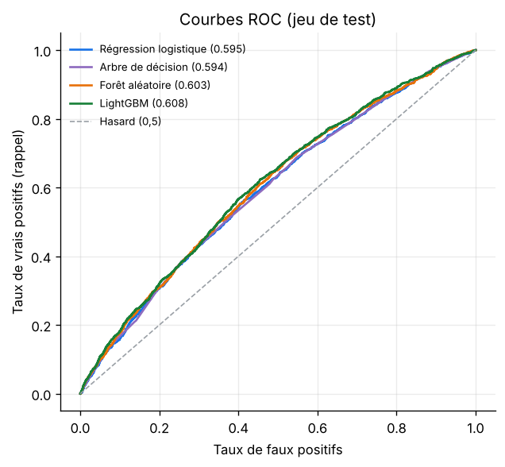
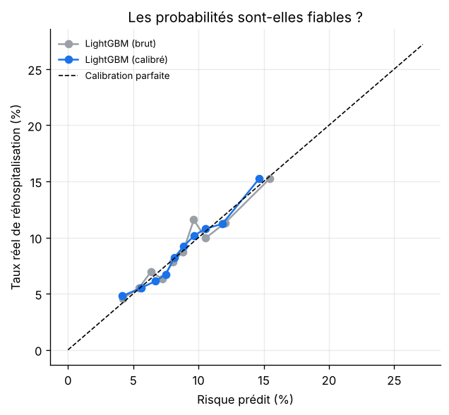
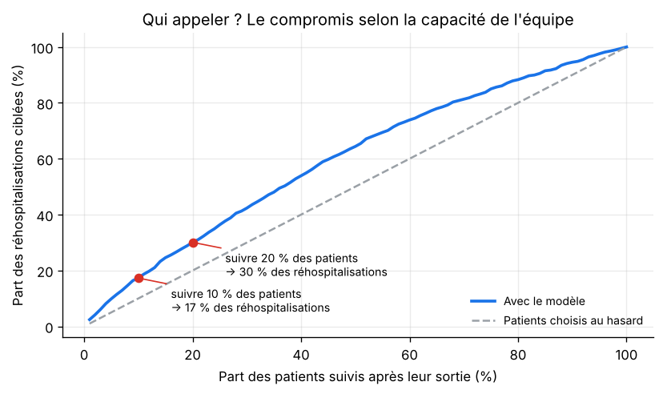
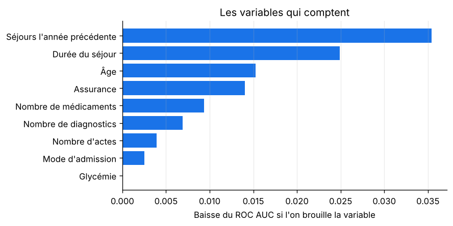
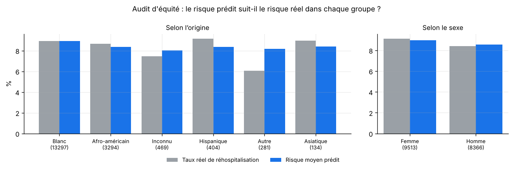

<div align="center">

# 🏥 Risque de réhospitalisation de patients diabétiques

**Repérer, à la sortie de l'hôpital, les patients diabétiques les plus à risque d'être réhospitalisés dans les 30 jours,
pour que l'équipe de suivi les appelle en priorité.**

Classification déséquilibrée · calibration · décision sous contrainte de capacité · audit d'équité


</div>

---

## 🎯 Le problème

Une réhospitalisation dans les 30 jours est souvent le signe d'une sortie trop précoce ou d'un suivi insuffisant.
Elle est coûteuse pour l'hôpital et pénible pour le patient. Un appel ou une visite après la sortie peut l'éviter,
mais l'équipe de suivi **ne peut pas appeler tout le monde**.

**La question** : si l'équipe peut suivre 10 % des patients, **lesquels choisir** ?

**Données** : 71 515 séjours de patients diabétiques dans 130 hôpitaux américains (1999-2008), publiés par Strack et al. (2014)
sur l'UCI Machine Learning Repository (licence CC BY 4.0), dans la version préparée par le paquet R `readmission`.
**8,8 %** des patients sont réhospitalisés dans les 30 jours : une classe rare.

---

## 🏆 Résultats en bref

| | |
|---|---|
| **Modèle** | LightGBM, ROC AUC **0,61** sur le test (régression logistique : 0,60) |
| **Suivre 10 % des patients** | cible **17 %** des réhospitalisations, contre 10 % au hasard (**×1,7**) |
| **Suivre 20 % des patients** | cible **30 %** des réhospitalisations (**×1,5**) |
| **Probabilités** | fiables : un risque prédit de 15 % correspond bien à environ 15 % de réhospitalisations |
| **Équité** | l'origine et le sexe ne sont pas utilisés ; le risque prédit suit le risque réel dans les principaux groupes |

> ⚠️ **Un résultat modeste, et c'est un résultat.** Avec les 9 informations disponibles ici (âge, durée du séjour, séjours passés…),
> la réhospitalisation est difficile à prévoir : les études publiées sur ce jeu obtiennent des ROC AUC du même ordre.
> Le projet montre comment **tirer le meilleur d'un signal faible** et comment **en parler honnêtement**,
> plutôt que de chercher un score spectaculaire.

---

## 🔬 La démarche

### 1. Explorer



Le signal le plus net : **les hospitalisations de l'année précédente**. Un patient sans séjour antérieur est réhospitalisé
dans 7,8 % des cas, contre 16 % pour un patient qui en a eu 5 ou plus. Les longs séjours sont aussi plus à risque.

### 2. Préparer les données avec soin

- **Valeurs manquantes informatives** : une glycémie « non mesurée » ou une assurance « non renseignée » est une information
  en soi ; elles deviennent des catégories plutôt que d'être remplacées par une moyenne.
- **L'origine et le sexe ne sont pas donnés au modèle.** Ils servent uniquement à vérifier, après coup,
  que le modèle ne désavantage aucun groupe (un test automatique le garantit).

### 3. Comparer 5 modèles



| Modèle | ROC AUC (validation) | ROC AUC (test) | PR AUC (test) | Réhospitalisations ciblées en suivant 10 % des patients |
|---|:-:|:-:|:-:|:-:|
| Référence (taux moyen) | 0,500 | 0,500 | 0,088 | 10,2 % |
| Arbre de décision | 0,585 | 0,594 | 0,118 | 15,6 % |
| Régression logistique | 0,595 | 0,595 | 0,119 | 15,4 % |
| Forêt aléatoire | 0,595 | 0,603 | 0,124 | 17,0 % |
| **LightGBM** | **0,600** | **0,608** | **0,127** | **17,4 %** |

- Pour une classe rare, le **PR AUC** est plus parlant que le ROC AUC : la référence vaut 0,088 (le taux de base),
  LightGBM 0,127, soit 44 % de mieux.
- **Règle fixée à l'avance** : si la régression logistique, plus simple et plus lisible, est à moins de 0,005 d'AUC du meilleur,
  on la retient. Ici l'écart est de 0,005 : LightGBM est retenu, de justesse.



### 4. Des probabilités fiables : la calibration



Pour décider, une probabilité doit **vouloir dire quelque chose** : parmi les patients à qui le modèle donne 15 % de risque,
environ 15 % doivent effectivement être réhospitalisés. LightGBM est déjà bien calibré ; un recalibrage isotonique a été testé
et n'apporte rien (score de Brier : 0,0793 dans les deux cas).

### 5. Décider sous contrainte de capacité



Plutôt qu'un seuil de probabilité abstrait, la décision part de **la capacité réelle de l'équipe** :

| Part des patients suivis | Patients appelés (test) | Réhospitalisations ciblées | Précision | Gain vs hasard |
|:-:|:-:|:-:|:-:|:-:|
| 5 % | 894 | 9,9 % | 17,3 % | ×2,0 |
| **10 %** | **1 788** | **17,3 %** | **15,2 %** | **×1,7** |
| 20 % | 3 576 | 30,1 % | 13,2 % | ×1,5 |
| 30 % | 5 364 | 42,3 % | 12,4 % | ×1,4 |

Le gain est le plus fort pour les tout premiers patients appelés, puis il diminue : c'est l'information qui permet à l'hôpital
de dimensionner son équipe.

### 6. Ce qui fait monter le risque



Rapports de cotes de la régression logistique (> 1 : le risque augmente), à autres caractéristiques égales :

| Facteur | Rapport de cotes |
|---|:-:|
| +1 séjour à l'hôpital l'année précédente | **×1,11** |
| +10 ans d'âge | ×1,08 |
| +1 diagnostic | ×1,04 |
| +1 jour d'hospitalisation | ×1,04 |
| +5 médicaments | ×1,03 |
| Assurance non renseignée (vs assurance privée) | ×1,44 |
| Medicaid, assurance publique des foyers modestes (vs privée) | ×1,27 |
| Sans assurance (vs privée) | ×1,17 |
| Medicare, assurance publique des plus de 65 ans (vs privée) | ×1,16 |

Le type d'assurance reflète en partie la **situation sociale** du patient : c'est un facteur connu de réhospitalisation,
qui renvoie à l'accès aux soins après la sortie.

### 7. Audit d'équité



En suivant 10 % des patients, on vérifie pour chaque groupe que le risque prédit suit le risque réel, et quelle part
des réhospitalisations est ciblée :

| Groupe | Patients (test) | Taux réel | Risque moyen prédit | Réhospitalisations ciblées |
|---|:-:|:-:|:-:|:-:|
| Femmes | 9 513 | 9,1 % | 9,0 % | 18,5 % |
| Hommes | 8 366 | 8,4 % | 8,5 % | 15,8 % |
| Blancs | 13 297 | 8,9 % | 8,9 % | 18,0 % |
| Afro-américains | 3 294 | 8,7 % | 8,4 % | 16,5 % |
| Hispaniques | 404 | 9,2 % | 8,4 % | 13,5 % |

- Pour les **groupes nombreux**, le risque prédit est très proche du risque réel (écart < 0,5 point) : le modèle est bien calibré
  dans chaque groupe.
- Les femmes sont un peu plus souvent sélectionnées que les hommes, ce qui correspond à leur taux réel plus élevé.
- Pour les **petits groupes** (404 patients hispaniques, soit 37 réhospitalisations), les écarts ne sont pas interprétables :
  quelques patients suffisent à faire varier les pourcentages de plusieurs points. Il faudrait plus de données pour conclure.

---

## 🚀 Lancer le projet

**Windows, en un double-clic** : `lancer.bat` installe tout, entraîne les modèles (environ 4 minutes) et ouvre les graphiques.

**À la main :**
```bash
python -m venv .venv
# Windows : .venv\Scripts\activate     macOS / Linux : source .venv/bin/activate
pip install -r requirements.txt
cd src && python -m rehospitalisation.train && cd ..
pytest -v      # 4 tests
```

---

## 🗂️ Organisation du code

```
rehospitalisation/
├── data/raw/readmission.csv       71 515 séjours (Strack et al., 2014 ; CC BY 4.0)
├── src/rehospitalisation/
│   ├── data.py                    Traduction, valeurs manquantes informatives, variables (sans origine ni sexe)
│   └── train.py                   Modèles, calibration, capacité de suivi, rapports de cotes, audit d'équité
├── models/model.joblib            Modèle calibré
├── reports/                       metrics.json et figures
├── tests/test_rehospitalisation.py 4 tests (dont : origine et sexe jamais utilisés)
└── lancer.bat
```

---

## 🧭 Limites et pistes

- **Peu de variables** : cette version du jeu ne contient ni les codes de diagnostic, ni les résultats d'analyses détaillés,
  ni les médicaments un par un. Les ajouter (jeu complet de l'UCI) est la première piste pour améliorer le modèle.
- Données de 1999-2008 : les pratiques médicales ont changé, le modèle devrait être réentraîné sur des données récentes.
- Un modèle de risque **ne dit pas qui bénéficiera du suivi** : un essai (ou un modèle d'*uplift*) mesurerait l'effet réel des appels.
- Ce projet est un exercice de data science, **pas un outil médical** : un usage réel demanderait une validation clinique.

---

## 👤 Auteur

**Elie Samson Kombiwo** — Data Scientist (MLOps / LLMOps)
[GitHub](https://github.com/gitsam1path) · [LinkedIn](https://www.linkedin.com/in/elie-samson-kombiwo-4075a4284)

<sub>Données : B. Strack et al., « Impact of HbA1c Measurement on Hospital Readmission Rates: Analysis of 70,000 Clinical Database
Patient Records », BioMed Research International, 2014 — UCI Machine Learning Repository (CC BY 4.0) —
via le paquet R [readmission](https://github.com/simonpcouch/readmission) (MIT).</sub>
